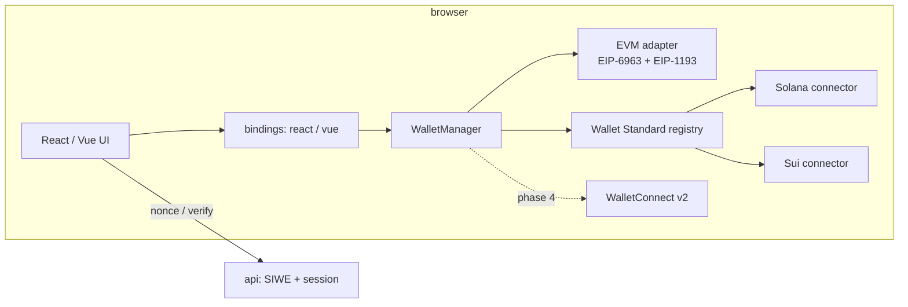

# OmniMarket

A multi-chain NFT marketplace built on its own wallet SDK: one adapter layer over EVM, Solana and Sui,
with React and Vue bindings over the same framework-agnostic core.

> Status: **phase 3**. Three ecosystems run end to end on local nodes:
> - EVM: EIP-6963 wallets, gasless EIP-712 listings;
> - Solana: Wallet Standard, Metaplex Core;
> - Sui: Wallet Standard, Move package, Kiosk.
>
> One sign-in (SIWE / CAIP-122) and one transaction history cover all three.

## Layout

```
packages/
  wallet-core/   framework-agnostic SDK: CAIP ids, WalletManager, store, error model
    src/adapters/evm/              EIP-6963 discovery, EIP-1193 connector (viem), chain add/switch
    src/adapters/wallet-standard/  shared discovery + connection lifecycle for Solana and Sui
    src/adapters/solana/           Solana connector (kit modifying signer, signMessage, signAndSend fallback)
    src/adapters/sui/              Sui connector (personal message, signTransaction, signAndExecute fallback)
    src/testing/                   real-key mock wallets: EIP-1193, Solana and Sui Wallet Standard
  auth/          SIWE (EIP-4361) + CAIP-122 for Solana/Sui: builder, strict parser, server verification, did:pkh
  tx-engine/     one TxStore, three engines: EVM (nonce replacements, reorgs), Solana (blockhash expiry,
                 rebroadcast, commitment), Sui (digest-first, idempotent resubmit, checkpoints)
  contracts/     Solidity (Foundry) + Move (omni_nft) + Metaplex Core/Kiosk helpers, safe metadata parsing
  react/         WalletProvider/TxEngineProvider, useAccount, useTransactions, useSiwe
apps/
  api/           Hono: SIWE + session, signed order book
  market-react/  Vite + React 19 marketplace: mint, list (gasless), buy, activity
docs/adr/        architecture decisions
```



## Run

Requires Node ≥ 22, pnpm, [Foundry](https://getfoundry.sh), the Solana (Agave) and Sui CLIs:
`brew install foundry solana sui`.

```bash
pnpm install
git submodule update --init   # forge-std
pnpm dev:chain                # anvil :8545, 2 s blocks, state persisted to anvil-state.json
pnpm deploy:local             # forge build + generate ABIs + deploy → deployments/index.json
pnpm dev:solana               # solana-test-validator :8899 with Metaplex Core loaded from solana/mpl_core.so
pnpm dev:sui                  # Sui localnet :9000 (gRPC) + faucet :9123, fresh genesis each start
pnpm --filter @omnimarket/contracts deploy:sui   # publish omni_nft → deployments/sui.json (after every dev:sui)
pnpm dev                      # api :8787, web :5173 (proxied as /api)

pnpm test                     # TypeScript unit + integration (spawn their own anvil / validator / localnet)
pnpm test:sol                 # Solidity: forge tests incl. fuzzing, EIP-1271, reentrancy
(cd packages/contracts/move/omni_nft && sui move test)
pnpm typecheck
```

> The local Solana validator ledger grows by roughly 2 GB/h. It is reset on every start (`--reset`); stop
> it when idle. Tests use a temp ledger and delete it.

Browsers without wallet extensions (CI, the built-in preview) can register real-key mock wallets in dev:
`await (await import('/src/dev/mockWallets.ts')).installMockWallets()`.

Import an anvil dev account (keys are printed by `anvil`) into MetaMask/Rabby, using the network
`http://127.0.0.1:8545` with chain id 31337.

Testnets: `RPC_URL=… DEPLOYER_PRIVATE_KEY=… pnpm --filter @omnimarket/contracts deploy` adds Sepolia/Amoy addresses
to `deployments/index.json`. The app and API pick them up automatically.

API environment variables:

| Variable | Default | Purpose |
|---|---|---|
| `PORT` | `8787` | |
| `SIWE_ORIGIN` | `http://localhost:5173` | Origin the SIWE `uri` must match; `https://` turns on `Secure` + `__Host-` cookies |
| `SIWE_DOMAIN` | host of `SIWE_ORIGIN` | Expected SIWE `domain` |
| `RPC_URL_<chainId>` | viem public RPC | Used only to verify smart-contract wallet signatures (EIP-1271 / 6492) |

## Security model (phase 1)

- **Discovery:** EIP-6963 announcements are untrusted. They are shape-checked, the first provider per rdns wins, and icons
  must be `data:image/*` and are rendered only via ``.
- **Signing:** the SDK refuses to sign for accounts that aren't connected, and refuses EIP-712 data whose
  `domain.chainId` differs from the wallet chain (cross-chain replay). Wallet prompts are never auto-retried.
- **SIWE:** the server issues a single-use nonce with a TTL. Domain and origin come from config, never the `Host` header.
  The server also checks the chain allowlist, issuedAt/expiration/notBefore with clock skew, and checks the signature (local
  ecrecover, then EIP-1271/6492 over RPC). Only then is the nonce consumed, atomically, so a valid message works once
  and junk requests can't burn nonces.
- **Session:** opaque random id in an `HttpOnly; SameSite=Lax` cookie. The id rotates on every login (session fixation), JSON-only
  POST (CSRF), `Cache-Control: no-store`, secure headers. The client drops the session when the wallet switches account.

## Security model (phase 2)

- **Pre-flight simulation:** every write is simulated first, so users never sign a transaction that would revert. Custom errors
  are decoded against all known ABIs: an OpenZeppelin error raised by the NFT inside a market call still gets a readable
  message.
- **Approvals:** `setApprovalForAll` is requested only for the verified market deployment (`isTrustedOperator`). The UI states
  what it grants, and the approval can be revoked from the app.
- **Gasless listings can't be edited:** the old signature stays fillable until it is cancelled on-chain. Raising a price
  therefore cancels the old order first. `incrementNonce` voids every signature at once.
- **The order book is a cache, not a source of truth:** the API checks the signature (EOA + EIP-1271), the collection allowlist,
  deadline bounds and per-seller limits. Both API and client re-check every order against the chain in one deployless multicall
  (used / nonce / owner / approval) before showing "Buy".
- **NFT metadata is untrusted:** only `data:application/json` is parsed locally, images are restricted to `data:image/*`, `https:`
  and `ipfs://` (via a gateway), `animation_url` is ignored, and nothing is rendered as HTML.
- **Contracts:** checks-effects-interactions plus `nonReentrant` (tested with a reentrant buyer), `_safeMint` with effects first,
  and EIP-1271 sellers through `SignatureChecker`.

## Security model (phase 3)

- **Wallet Standard:** wallet registrations are untrusted like EIP-6963 announcements. Icons are sanitized, and only wallets with
  the namespace and the required feature set are listed. Accounts of other chains in multi-chain wallets are filtered out.
- **Signing exactly what was shown:** a Solana wallet that returns a signature over *different* bytes than requested
  (prefixing, rewriting) is rejected rather than forwarded.
- **Sign-in on every chain:** the same nonce, domain, origin, chain allowlist and time checks apply. Solana sign-in uses ed25519
  over the exact text. Sui verifies personal-message signatures with intent domain separation, so a transaction signature can't
  be replayed as a sign-in (tested). Multi-line statements are refused (field injection), and the parser rejects unknown or
  duplicate fields.
- **Kiosk:** purchases resolve the `TransferRequest` against the type's `TransferPolicy` inside the same programmable transaction.
  Listings found through events are re-checked against the current kiosk state.

## Transaction lifecycle

See [ADR 0002](docs/adr/0002-transaction-lifecycle.md) (EVM) and [ADR 0003](docs/adr/0003-wallet-standard-and-chain-lifecycles.md)
(Solana, Sui).

| | EVM | Solana | Sui |
|---|---|---|---|
| Pre-flight | `simulateContract`, custom errors from all ABIs | `simulateTransaction` (errors + compute units) | build dry-run + simulate, Move clever errors |
| Fees | wallet decides; ×1.125 bump on replace | CU limit = measured ×1.1, priority fee = median recent | gas budget from dry-run |
| Validity | nonce | blockhash until `lastValidBlockHeight` | owned object versions |
| Resend | speed-up/cancel (same nonce) | rebroadcast every 2 s, `maxRetries: 0` | re-execute same signed bytes (idempotent) |
| Done when | N confirmations, reorg → pending | `confirmed`/`finalized`, fork drop → pending | effects → checkpoint |
| Terminal failures | reverted (reason by replay), dropped, replaced | expired (safe to retry), program error by name | Move abort with constant name, dropped |

EVM details:

- **States:** `preparing → awaiting_signature → pending → confirming → confirmed`, or `failed` (simulation / rejected /
  reverted with a decoded reason / dropped), `cancelled`, `replaced`.
- **Same-nonce attempts:** speed-up and cancel add attempts to one record. A speed-up done in the wallet's own UI (unknown hash)
  is found by binary-searching the account nonce over blocks and classified as repriced, cancelled or replaced.
- **Reorgs:** a receipt that disappears sends the record back to `pending`. N confirmations are configurable.
- **Weak networks:** RPC fallback transport, exponential backoff on polling errors, an immediate re-poll on `online` and
  tab-visible, and a `syncError` flag in the UI.
- **Reloads:** records are persisted and resumed. Prompts open during a reload are marked `interrupted`.

## Roadmap

| Phase | Scope |
|---|---|
| 1 ✅ | wallet-core, EVM adapter, SIWE, React bindings |
| 2 ✅ | tx-engine, OmniNFT + OmniMarket (EIP-712 orders), order book API, marketplace UI |
| 3 ✅ | Wallet Standard adapters for Solana and Sui, CAIP-122 sign-in, Solana/Sui tx engines, Metaplex Core, Move package + Kiosk |
| 4 | WalletConnect v2: one session across eip155/solana/sui namespaces, mobile deep links, PWA |
| 5 | Vue 3 shell + Pinia bindings, Module Federation with the React app as a remote, UI library + Storybook |
| 6 | Performance budget (lazy chain SDKs, virtualized grids, workers, RPC fallback), approval/permit warnings, threat model |

Production bundle (gzip JS): **125 kB** after phase 1, **174 kB** after phase 2. After phase 3 the main chunk is **93 kB**:
the Solana page with Metaplex Core (55 kB) and the Sui modules with Kiosk (~22 kB) load only when a wallet of that ecosystem
connects. Phase 6 continues with the chain SDKs used by the wallet adapters themselves.

Known limitations:
- Solana has mint and transfer but no listings: a Core marketplace needs an escrow program.
- The Kiosk SDK's listing-price decoding is wrong on the gRPC transport, so prices come from `ItemListed` events.
