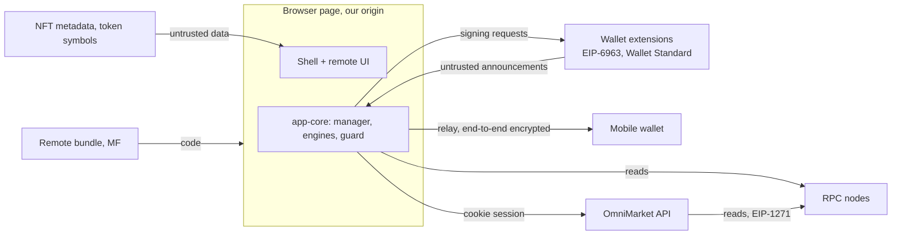

# OmniMarket threat model

What can go wrong for a user of OmniMarket, what the code does about it, and what is left. Scope: the
frontends (React marketplace, Vue shell), the SDK packages, the API and the contracts in this repository.
The wallets, the chains and the WalletConnect relay are outside it, but where they are trusted is stated.

## Assets

| Asset | Where it lives | Worst case |
|---|---|---|
| Tokens and NFTs in the user's wallet | on chain, controlled by the wallet's key | drained by a signature the user didn't understand |
| Standing permissions: allowances, `setApprovalForAll`, permits | on chain, or off chain as a signature | used later, long after the user forgot them |
| Signed listings (EIP-712 orders) | API order book, any copy of the signature | filled at an old price |
| The sign-in session | `HttpOnly` cookie, API memory | someone acts as the user in the API |
| The WalletConnect session | relay + SignClient storage in the browser | requests sent to the phone in the user's name |
| Transaction history | `localStorage` | misleading status ("confirmed" when it isn't) |

## Trust boundaries

Trusted: our origin and the bundles it serves (the shell decides which remote to load), the user's wallet
holding the key, the chain's consensus. Not trusted: anything an extension, a WalletConnect peer, an RPC
node, the order book or a token contract tells us about itself.

## Threats and mitigations

### 1. The user signs something that drains them (phishing, malicious dApp, compromised frontend)

The most common loss in practice. Wallets show raw hex or a generic "Signature request" for most of these,
and users approve what they can't read.

| Threat | Mitigation | Where |
|---|---|---|
| Unlimited ERC-20 `approve` / `increaseAllowance` | decoded; "unlimited" (≥ 2¹²⁸) is a warning with the amount the user would grant | `guard/src/transaction.ts` |
| Approval to a personal address (the usual drainer setup) | `getCode` on the spender: no code → danger | `guard/src/report.ts` |
| Spender is an EIP-7702 delegated EOA | `0xef0100‖addr` code is treated as a personal address: its key can swap the code | `guard/src/chain.ts` |
| `setApprovalForAll` for an unknown operator | warning, plus the operator check; only our verified market passes silently | `guard`, `contracts/ts/deployments.ts` |
| ERC-721 `approve` disguised as ERC-20 (same selector) | ERC-165 `supportsInterface(0x80ac58cd)` decides how it is described | `guard/src/chain.ts` |
| Gasless permits: EIP-2612, DAI, Permit2 (allowance and transfer) | decoded from the EIP-712 types, not the type name. Flagged: no transaction and no history, unlimited amounts, deadlines over 30 days or never | `guard/src/typed-data.ts` |
| Fake "Permit2" domain pointing at another contract | danger: Permit2 is only the canonical address | `guard/src/typed-data.ts` |
| An approval hidden in an EIP-5792 batch | every call of `wallet_sendCalls` is inspected | `guard/src/transaction.ts` |
| `eth_sign` (signs any 32 bytes, a transaction hash included) | blocked, never forwarded | `guard/src/message.ts` |
| A bare hash in `personal_sign` | danger: unreadable, may be an order elsewhere | `guard/src/message.ts` |
| Sign-in message for another domain | danger, before the wallet opens. The server checks it independently anyway | `guard/src/message.ts`, `auth/src/server.ts` |
| Invisible or bidi characters making a message read differently | warning | `guard/src/message.ts` |
| A token calling itself "USDC" | symbols are sanitized, marked "unverified" and always shown with the address; only app-known contracts are shown by name | `guard/src/report.ts` |

The checks run as an EIP-1193 middleware around every EVM provider, extensions and WalletConnect alike,
so there is no signing path around them (ADR 0006). If a request can't be analyzed (RPC down, a bug), it
goes to a review instead of passing. If no review UI is mounted, it is rejected.

**Residual.** The guard only knows what it decodes. A malicious *contract* behind a harmless-looking call
(`multicall`, a router with an arbitrary `calldata`) shows as "a contract this app can't describe". It
passed simulation, but a simulation doesn't show where assets go. That is what transaction simulation
with balance diffs (Tenderly, Blockaid) would add. Seaport-style orders and Solana/Sui instructions
(`Approve`, `SetAuthority`, object transfers) are not decoded yet. A frontend compromised at build time
can remove the guard. That one is defended by the wallet, not by us.

### 2. Cross-chain and replay

| Threat | Mitigation | Where |
|---|---|---|
| EIP-712 signature for another chain | refused in the connector (`CHAIN_MISMATCH`) and blocked by the guard | `wallet-core/.../evm/connector.ts`, `guard` |
| Typed data without `chainId` | warning: valid on every chain | `guard/src/typed-data.ts` |
| Sign-in replay | single-use nonce with TTL, consumed atomically only after full verification | `auth/src/server.ts` |
| Sui transaction signature replayed as a sign-in | personal-message intent domain separation (tested) | `auth/src/siwx.ts` |
| Old listing filled after a price change | raising a price cancels the old order on chain first; `incrementNonce` voids everything | `ListForm.tsx`, `OmniMarket.sol` |

### 3. Untrusted wallets and peers

| Threat | Mitigation |
|---|---|
| A malicious extension impersonating another (EIP-6963) | first announcement per rdns wins, shape checks, icons only `data:image/*` rendered via `` |
| A wallet signing different bytes than asked | Solana: signed message must equal the requested bytes. Sui over WalletConnect: same bytes, signature verified locally |
| A WalletConnect peer granting garbage | only requested chains and methods with valid addresses are kept. A session with nothing usable is closed |
| Peer metadata as an attack vector | name sanitized, redirect only to safe schemes, remote icons not loaded |
| Phone woken for reads, or lying about chain state | reads never go to the wallet: chain id, simulation, gas and receipts use our RPC |

### 4. Session and API

| Threat | Mitigation |
|---|---|
| Session fixation, theft via XSS | id rotated on login, `HttpOnly`, `__Host-` + `Secure` over https, no token in JS |
| CSRF | `SameSite=Lax`, JSON-only POST |
| Domain spoofing via `Host` | SIWE domain and origin come from config |
| Order book poisoning | signature (EOA + EIP-1271), collection allowlist, deadline bounds, per-seller limits; client re-checks every order on chain before "Buy" |
| Nonce exhaustion | nonces are consumed only by a fully valid message |

**Residual.** Sessions are in memory (one instance). Rate limiting is per process, not distributed.

### 5. Data rendered in the UI

| Threat | Mitigation |
|---|---|
| Script in NFT metadata | only `data:application/json` parsed locally, images `data:`/`https:`/`ipfs://`, `animation_url` ignored, nothing rendered as HTML |
| Script in web component inputs | Lit templates escape, wallet icons re-sanitized inside the component |
| Tracking through remote images | wallet and peer icons are never fetched from the network |

### 6. Supply chain and micro-frontends

| Threat | Mitigation |
|---|---|
| Two copies of the wallet SDK (two sessions, stale state) | Module Federation singletons, `Symbol.for` brands for cross-bundle `instanceof` |
| An incompatible remote half-working | versioned mount contract; the shell refuses it and keeps working |
| Remote CSS breaking the host | styles nested under `.omni-market`, removed on unmount |
| A dependency update changing WalletConnect behaviour | `@walletconnect/*` pinned to exact versions |

**Residual.** No SRI for the remote entry (Module Federation loads it at runtime); deploy both from one
origin or pin the remote URL. No CSP header in the dev servers. A production deployment should set
`script-src 'self'` plus the remote origin, and `connect-src` for the RPC and the relay.

### 7. Availability and integrity of status

| Threat | Mitigation |
|---|---|
| RPC outage or rate limit | fallback transport (private RPC first), exponential backoff, `syncError` shown |
| Reorg turning "confirmed" back | receipts re-checked until N confirmations; a vanished receipt → `pending` |
| Replacement by the wallet (speed-up) or another transaction | nonce-based detection, classified as repriced / cancelled / replaced |
| Stale UI after reload | records persisted and resumed; prompts open during a reload are `interrupted` |
